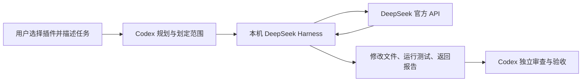

# Codex DeepSeek Executor

[English](README.en.md) · [MIT License](LICENSE)

一个按需使用的 Codex 本机插件：**Codex 负责规划和验收，DeepSeek Harness 负责实现、调试和测试。**

在输入框选择「DeepSeek 执行助手」后描述任务即可。插件自带 Python 调用器和配置向导，不需要某个作者电脑上的脚本、私人路径或 API Key。



这是社区集成项目，与 OpenAI 或 DeepSeek 无官方从属关系。软件通过本地子进程委派任务，使用者仍需自行安装官方 Harness 并配置自己的 API Key。

## 支持范围

| 项目 | 当前范围 |
|---|---|
| 执行环境 | macOS；真实运行在 Apple Silicon 上验证 |
| Python | 3.9+，只用标准库 |
| Codex | 支持本地插件市场的桌面端或 CLI；安装命令在 CLI 0.146.0 验证 |
| Harness | **0.2.1-rc.2**，不自动接受未测试的版本 |
| 提供商 / 模型 | `deepseek-official` / `deepseek-flash`，推理等级 `high` |
| 默认权限 | `workspace-write` 与 `approval: ask` |
| 调用方式 | 用户选择插件或明确点名时启动，普通任务不自动委派 |

Windows、Linux、其他 Harness 版本和无本机执行环境的网页/手机聊天，尚不在本版本支持范围。离线测试在 Linux 上运行不代表 Linux 的真实沙箱已经验证。

## 安装

### 1. 准备依赖和认证

安装 [Codex](https://developers.openai.com/codex/) 和 [DeepSeek Harness](https://github.com/deepseek-ai/deepseek-harness)。确认版本：

```sh
codex --version
dsh --version
```

macOS 桌面版 Harness 随应用附带 CLI；即使没有把 `dsh` 加入 PATH，配置向导也会检查标准应用路径。其他位置可以用 `--dsh '/absolute/path/to/dsh'` 明确指定。

在 Harness → 设置 → 模型 → **DeepSeek（官方 API Key 通道）**，直接在本机保存自己的 Key。账户登录通道与 API Key 通道不同。本插件不提供 Key，不从聊天索取 Key，也不要求 OpenAI API Key。

默认引用 `~/.dsh/.credentials.yaml`。该文件必须归当前用户所有，且仅本人可访问；插件不会读取其密钥内容或擅自修改权限。

### 2. 安装插件

```sh
codex plugin marketplace add 18011449431/codex-deepseek-executor
codex plugin add deepseek-executor@codex-deepseek
```

本仓库自带 `.agents/plugins/marketplace.json`，市场名是 `codex-deepseek`。安装后重开桌面应用并新建聊天。在输入框输入 `@`，搜索并选择 **DeepSeek 执行助手**；完整技能名为 `$deepseek-executor:deepseek`。

如果组织策略限制自定义市场，请遵守管理员配置。安装机制参见 [OpenAI 官方插件文档](https://developers.openai.com/plugins/build/plugins)。

### 3. 初始化本机执行配置

选择插件后先让 Codex 检查配置；未初始化时，插件会调用随附的 `setup.py`。也可以手动执行：

```sh
git clone https://github.com/18011449431/codex-deepseek-executor.git
cd codex-deepseek-executor
python3 skills/deepseek/scripts/setup.py
python3 skills/deepseek/scripts/run.py --check
```

配置向导不会发起模型请求。它会创建 `~/.local/share/codex-deepseek-executor/`，在其中建立独立 Harness home 和执行 profile，并引用已有的管理凭据文件。它不会改写 Harness 桌面配置或全局 AGENTS.md，也不会复制已有 Key。

`--check` 只确认版本、配置和文件权限，不能证明 Key 有效或余额充足。自定义位置：

```sh
python3 skills/deepseek/scripts/setup.py \
  --dsh '/absolute/path/to/dsh' \
  --credentials-file '/absolute/private/.credentials.yaml' \
  --state-dir '/absolute/private/executor-state'
```

若使用自定义 state，之后调用 `run.py` 时也要传入同一个 `--state-dir`。状态目录和凭据目录应放在项目工作区之外。已有未知内容或中断的配置目录不会被覆盖；请使用新的空目录。

## 使用

选中插件后，例如：

> 为这个项目实现登录页面并运行测试。你先确定改动范围，将完整实现和调试交给 DeepSeek，最后审查差异并验收。

Codex 会检查项目指令与现有改动，给 DeepSeek 一份完整任务，通过独立子进程执行，再审查实际文件和测试结果。仅询问插件功能、状态或费用时，不应调用付费模型。

手动调用时，在 `task.txt` 中写清楚目标、可改文件、禁止操作、测试命令和完成标准：

```sh
python3 /absolute/plugin/skills/deepseek/scripts/run.py \
  --workspace '/absolute/project' \
  --task-file '/absolute/task.txt' \
  --result '/absolute/new-result.json' \
  --timeout 900
```

替换示例中的占位路径。任务经 stdin 传给 Harness，不进入 shell 命令或进程参数。任务最多 64 KiB。结果文件必须是新路径，以 0600 权限创建；未指定 `--result` 时只输出 JSON。

结果含 `completed`、`exit_code`、`turn_reason`、`protocol_error`、工具名称、provider 报告的 token 用量和最终报告。**模型自报成功或退出码 0，不等于业务验收通过。** Codex 仍需审查差异并运行必要验证。shell 内部非零退出不一定会计入 `tool_errors`。

退出码：0 = 原生任务正常结束并有最终报告；1 = 失败、未完成或超时；2 = 配置/参数/启动错误；130 = 用户取消。异常退出时，预留的结果文件可能为空，须同时查看退出码和错误信息。

## 权限、数据和费用

- 固定保留工作目录写入沙箱和审批；无可用审批回答器时，额外权限请求会被拒绝，不自动提升权限。
- 原生保护主要限制**写入**。它不全面隔离目录外读取和出站网络，不适合用来围堵恶意项目或指令。父 Codex 的权限限制仍然适用。
- 执行会把任务和工具选取的项目内容发送给 DeepSeek。不要在任务、结果、Issue 或提交中放入密钥、私人数据或原始会话。
- 包装器不保存原始推理或工具正文，输出脱敏只是尽力处理。Harness 自身仍会在隔离 home 下记录会话日志；这些状态和日志不应上传。
- 默认最长 900 秒，可设置 10–3600 秒；单次模型输出上限 8192 token。**时间和输出限制都不是金额上限。**
- DeepSeek 使用独立 API 余额；Codex 的规划、工具交互和审查仍消耗 Codex 额度。本项目未承诺节省比例，也不会提高 Codex 额度上限。价格以 [DeepSeek 官方页面](https://api-docs.deepseek.com/quick_start/pricing/) 为准，Codex 规则见 [官方用量说明](https://developers.openai.com/codex/pricing)。

更多实现边界见 [运行说明](skills/deepseek/references/runtime.md) 和 [安全说明](SECURITY.md)。

## 常见问题

| 情况 | 处理方式 |
|---|---|
| 找不到插件 | 重新打开应用，新建聊天；确认市场和插件已安装、未被组织策略禁用 |
| 找不到 dsh | 安装官方 Harness，检查终端命令管理入口，或传 `--dsh` |
| `Unsupported Harness runtime` | 当前只验证 0.2.1-rc.2；不要移除版本检查来绕过错误 |
| `MISSING_CREDENTIAL` | 在本机 Harness 的官方 API Key 通道保存 Key；账户登录不等于 API Key 已保存 |
| 凭据文件权限不私密 | 在本机核对所有者与权限；不要把文件内容发到聊天或 Issue |
| 配置指纹变化 / 运行时升级 | 停止使用，检查兼容性并重跑验收，再用新的 state 目录初始化；不要手动改哈希压掉错误 |
| 超时或权限拒绝 | 查看任务范围及实际错误；不要自动改成完全权限或无限重试 |

停用时不选择插件即可；卸载可运行 `codex plugin remove deepseek-executor@codex-deepseek`。卸载插件不自动删除运行状态、日志或原有凭据。需要清理时只处理自己创建的 state，保留原始 `~/.dsh` 凭据与桌面配置。

## 开发与验证

```sh
python3 -m unittest discover -s tests -v
python3 -m compileall -q skills tests
```

离线测试不需要 API Key，也不会调用模型。它们验证字面量 stdin、环境过滤、超时与进程清理、结果文件保护、配置漂移和失败状态等。真实模型、实际编辑及 macOS 目录外写入拒绝需要单独人工验收，并会产生 API 费用。

欢迎提交小范围改进，见 [贡献说明](CONTRIBUTING.md)。原始集成代码、技能和图标按 [MIT](LICENSE) 发布；Harness、模型服务、Codex 和商标的许可及条款独立适用。
